# Airspace Collision Risk Prediction

## Abstract

This project investigates whether machine-learning models can identify potential aircraft-pair collision risk from Automatic Dependent Surveillance-Broadcast (ADS-B) telemetry. The research focuses on Southern California airspace and is designed to compare a graph neural network baseline with a Temporal Fusion Transformer (TFT) once sufficient historical trajectory data has been collected.

The study first examined imbalance-aware classification strategies for the rare collision-risk event, and then extended the workflow to graph-based representations of aircraft interactions. The work in this phase was designed to evaluate how class imbalance affects safety-critical detection and to ensure that the later graph formulation preserves the same collision-risk signals used in the base feature pipeline.
An initial imbalance study used a single snapshot. The project has since added a 58-minute backfill, allowing repeated aircraft-pair observations, encounter duration, trajectory geometry, and candidate label definitions to be examined. These newer analyses are exploratory and use the existing rule-based label; they do not identify confirmed collision events.
## Section I
### Introduction

Mid-air collision prevention is a safety-critical prediction problem with two important characteristics. First, risk belongs to a relationship between two aircraft rather than to one aircraft in isolation. Second, a possible conflict develops over time: distance, altitude, heading, speed, and the projected point of closest approach must be considered together.
This project therefore represents aircraft as interacting entities and creates features for aircraft pairs that are geographically close. The longer-term research goal is to compare two model families:

- A graph neural network (GNN) that represents aircraft as nodes and nearby aircraft pairs as edges.
- A Temporal Fusion Transformer (TFT) that uses sequences of pair features over time.

The imbalance analysis identified the most reliable strategy for a highly skewed collision-risk label, and the subsequent graph formulation translated the same kinematic features into a spatial representation suitable for modeling aircraft interaction patterns.This stage was important because collision-risk prediction is a safety problem, so the model selection process needed to balance recall, precision, and the cost of false negatives rather than relying only on aggregate accuracy.

## Section II
### Related Work

The project builds on a data pipeline that combines ADS-B state information, pairwise feature engineering, and rule-based labeling for collision-risk detection. A structured exploratory analysis was used to assess class imbalance, feature quality, and the suitability of the generated pair features for downstream modeling.

This section reflects the practical work carried out to select a more robust classification strategy and to convert the same pairwise signals into a graph representation that better captures aircraft-to-aircraft interaction.The methodology compared baseline performance under different imbalance-handling strategies to select the most suitable approach for collision-risk detection, and then transformed aircraft snapshots into graphs where nodes represent aircraft and edges encode proximity and interaction features.

## Section III
### Proposed Methodology

#### Dataset description and Preprocessing
The methodology uses ADS-B state-vector data collected from the OpenSky Network for Southern California. The data dictionary records the available fields, units, and known data-quality issues. NTSB accident records were collected separately for background context. A recent authenticated backfill added 349 frames over a 58-minute period; this supports short-window encounter analysis, but it is not a substitute for the longer historical record needed to study different dates and seasons.

##### Feature Engineering
The pipeline converts aircraft observations into pairs within 50 nautical miles. For each pair, it calculates horizontal distance, closing speed, bearing difference, vertical separation, and time to the closest point of approach. Ground aircraft and stale position reports are filtered before pair construction. Under the current rule, a pair is labeled risk when lateral separation is at most 5 nautical miles and vertical separation is at most 1,000 feet. Pair features are built within each snapshot so aircraft are not paired across different times. Further data-quality and multi-day analysis is still needed before drawing general conclusions or evaluating temporal models.

The methodology prioritised imbalance-aware evaluation and then represented aircraft as interacting nodes with edge attributes that reflect distance, closing speed, and time-to-CPA. This setup supports graph-based learning without changing the original modeling foundation already described in the file.The graph construction step was designed to preserve the key collision-risk cues from the pair-feature pipeline while adding the relational structure needed for a graph neural network baseline.
## Section IV
### Results and Discussion

#### Progress on the Revised Plan: Steps 1–8

**Step 1 — Backfill data collection.** An authenticated OpenSky backfill collected 349 frames at approximately 10-second spacing across a 58-minute window. The resulting pair-feature dataset contains 4,158,918 pair-observations. This provides a short continuous sample for studying encounters, although it does not cover multiple days or seasons.

**Step 2 — Professor follow-up.** A progress update and questions about the risk-label definition were prepared for discussion with the professor. The current labels have not been changed; a final definition remains subject to his guidance.

**Step 3 — Are the positive observations distinct situations?** The current separation rule labels 24,016 pair-observations as positive, or 0.577% of all pair-observations. Grouping the same aircraft pair into one encounter when positive observations are no more than 60 seconds apart gives 2,394 encounters, approximately 10 positive rows per encounter. The median encounter contains 7 observations and lasts 60 seconds. The longest lasts about 20.5 minutes and contributes 112 positive observations. This shows that positive rows are repeated measurements, not all independent situations.

Connected-component analysis found 508 components. The largest contains 11,882 positive observations (49.5%); the top five contain 67.5%, and the top 25 contain 79.8%. These components can join through chains of aircraft and frames, so they should not be interpreted as individual real-world incidents. They do show why a random row-level train/test split could place related observations in both sets.

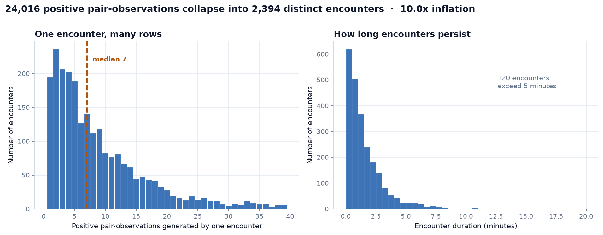

This figure shows how many positive rows each encounter contributes and how long those encounters last. Most are short, while a few persistent encounters create many repeated rows.

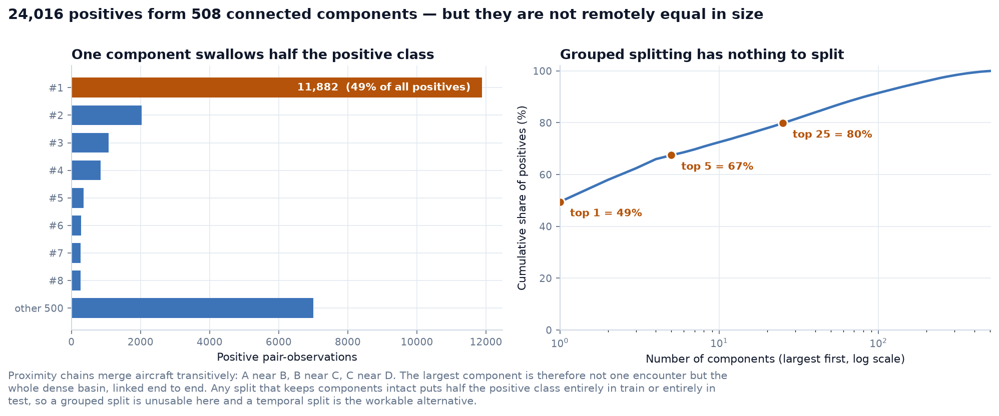

The largest connected component contains about half of the positives. This is a warning about dependence in the data, not evidence that half the positives belong to one physical event.

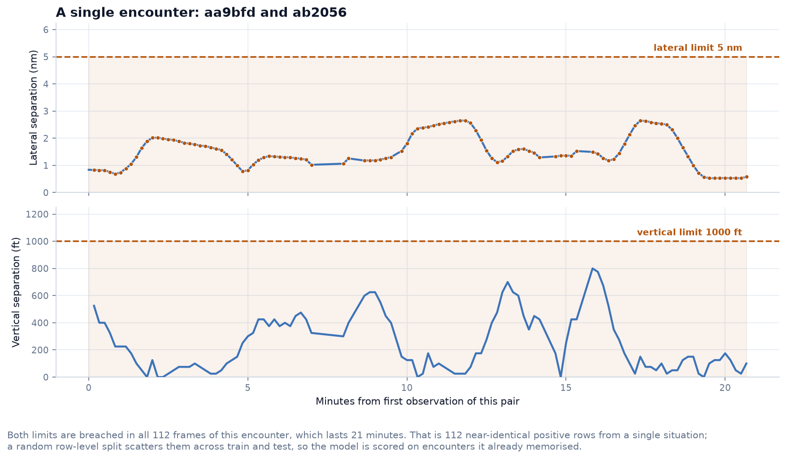

This example follows one aircraft pair over its longest positive encounter. It illustrates how a single pair can produce many positive observations while remaining within the current thresholds; it does not establish whether the close flight was intentional or unsafe.

**Step 4 — Geometry and location.** At the observation level, 51.5% of the current positives have non-positive closing speed, meaning the aircraft were not getting closer at that observation. An encounter-level heuristic classified 1,228 encounters as separating, 738 as crossing, 227 as head-on, 185 as overtaking, and 16 as parallel/formation. These are descriptive categories based on median bearing difference and closing speed, not verified operational labels.

Encounter locations cluster around the Los Angeles basin, with a smaller concentration near San Diego. The median distance from an encounter midpoint to the nearest of six selected airports is 9.2 nautical miles; 53.2% are within 10 nautical miles. This map contains positive encounters only, so it does not establish that these locations have higher risk rates than areas with more safe traffic.

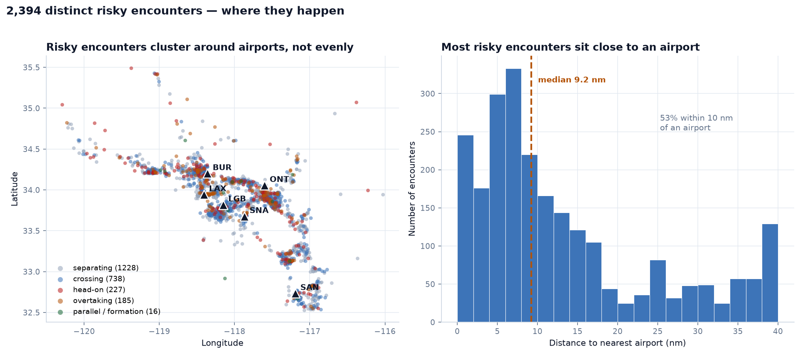

This map shows where the positive encounters occurred during this collection window. Its geographic clusters are descriptive; a safe-traffic denominator is needed for regional risk-rate comparisons.

Using all pair-observations as denominators, the current-rule positive rate is 1.70% below 3,000 feet, 0.41% from 3,000 to 10,000 feet, 0.014% from 10,000 to 18,000 feet, and 0.011% at or above 18,000 feet. The higher rate at low altitude may reflect routine traffic patterns as well as the behavior of the current label; this one window cannot establish a general safety relationship.

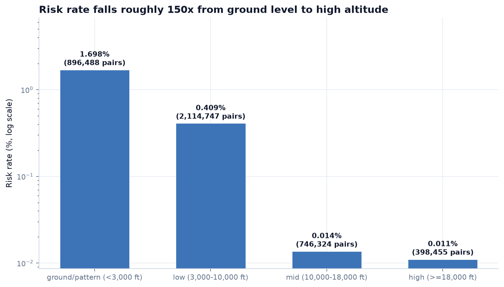

The rate is highest in the below-3,000-foot band and falls sharply at higher altitudes. The logarithmic vertical axis makes the small high-altitude rates visible.

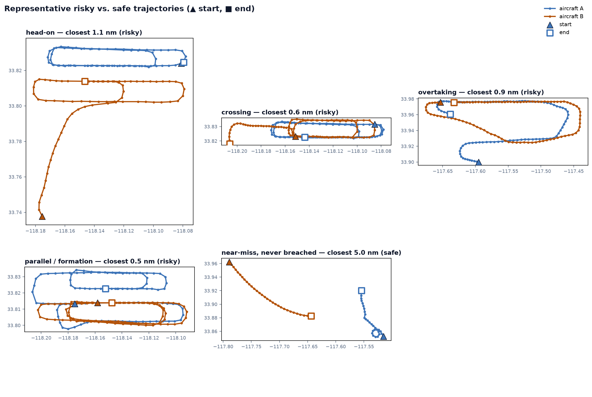

These selected paths illustrate several movement patterns among positive encounters and one nearby pair that did not meet both current thresholds. They are examples for visual inspection, not a representative sample of every positive or safe pair.

**Step 5 — Label-rule sensitivity.** The current rule produces 24,016 positive observations. Requiring positive closing speed reduces this to 12,360. Adding a time-to-CPA limit of 5, 10, 15, or 30 minutes gives 11,183, 11,929, 12,152, and 12,299 observations. Requiring convergence makes the largest difference in this comparison; changing the tested CPA horizon makes a smaller difference.

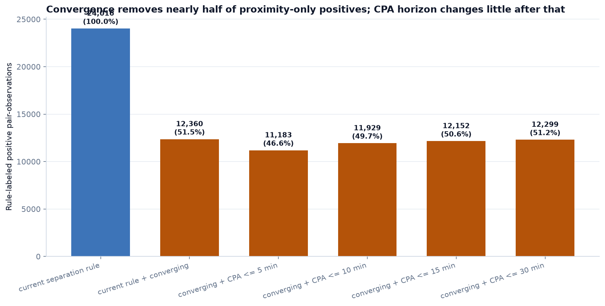

This comparison shows how the positive count changes when convergence and a CPA time horizon are added. The candidates do not test predicted separation distance at CPA, so they are not yet complete alternative risk labels. The existing labels remain unchanged pending discussion with the professor.

**Step 6 — Temporal train/validation/test split.** The original backfill-only assignment divided frames by time: the first 60% was used for training, the next 20% for validation, and the final 20% for testing, with a two-minute gap after each boundary. Training covered minutes 0.0–34.7, validation 36.8–46.3, and test 48.5–58.0. The gap was chosen by measuring its effect. Without a gap, 136 encounters had positive observations in two parts; with two minutes, 49 did, at the cost of 6.8% of positive observations. No encounter appeared in both training and test at any gap size. A grouped split was not used because the largest connected component from Step 3 holds about half of the positives.

The split leaves 13,822 positive observations for training, 4,376 for validation, and 4,173 for testing. The positive rate is 0.56% in training and about 0.61% in validation and test, reflecting a small rise across the window that a random split would have mixed together.

**Updated split for the multi-session collection (2026-10-08).** The saved assignment was regenerated from the 2026-09-25 backfill and the four 2026-10-07 poll sessions. Whole sessions are kept together: the backfill and 6:39 AM and 10:18 AM sessions (661 frames total) are training; 2:30 PM (168 frames) is validation; and 7:39 PM (169 frames) is test. No frame is in a gap or missing from the assignment. The preceding split counts and validation results describe the earlier, backfill-only temporal split; they are not scores from this new assignment. The pair features are rebuilt frame by frame from these raw sessions when the models run. Since validation and test each contain just one session from the same date, they measure later-session performance on that date, not generalization to new days or seasons.

The baselines and the graph model now share one preparation step and use the same 4,156,014 pair-observations. The original Week 3 loader dropped every pair without a future closest approach, which removed 11,656 positives (49%); in effect it trained only on converging pairs. These pairs are now kept, with time to closest approach capped at one hour, log-scaled, and accompanied by a flag indicating whether a closest approach exists.

The four Week 3 strategies were retrained on the backfill and scored on the validation part. The test part was not used, so that it remains held out for the later model comparison. The table also includes normalised cost, which counts a missed positive as five false alarms and divides by the cost of never predicting risk: 0 is perfect and 1 is no better than ignoring the problem.

| Split | Strategy | Normalised cost | Recall | Precision | Average precision | AUROC |
|---|---|---:|---:|---:|---:|---:|
| temporal | baseline | 0.275 | 0.754 | 0.837 | 0.895 | 0.9993 |
| temporal | SMOTE | 0.203 | 1.000 | 0.497 | 0.900 | 0.9993 |
| temporal | class weight | 0.238 | 1.000 | 0.457 | 0.900 | 0.9993 |
| temporal | focal loss | 1.000 | 0.000 | 0.000 | 0.266 | 0.9903 |
| random | baseline | 0.253 | 0.780 | 0.826 | 0.898 | 0.9994 |
| random | SMOTE | 0.209 | 1.000 | 0.489 | 0.909 | 0.9994 |
| random | class weight | 0.235 | 1.000 | 0.459 | 0.908 | 0.9994 |
| random | focal loss | 1.000 | 0.000 | 0.000 | 0.249 | 0.9897 |

The random and temporal splits produced similar scores for these models. One possible explanation was that the label, being a direct function of two input features, left nothing for a model to memorise; however, removing those features did not widen the gap either. A more likely reason is that logistic regression has too little capacity to benefit from seeing near-duplicate observations of the same encounter. This experiment therefore does not show that a random split inflates logistic-regression results. The temporal split is retained because it matches forward prediction and because higher-capacity models, including the planned graph and sequence models, are more able to exploit repeated encounters.

Removing the two label-defining features changed the results sharply: AUROC fell from 0.999 to about 0.75, and average precision from about 0.90 to 0.018, against a positive rate of about 0.6%. Under the current rule, the high scores therefore come mainly from the models reconstructing the separation thresholds from lateral distance and vertical separation. The remaining kinematic features carry only a weak signal for this label.

SMOTE gave the lowest normalised cost under the current label and a fixed 0.5 threshold, missing no validation positives, with class weighting close behind. This agrees with the preliminary Week 3 selection, now based on 4,376 validation positives rather than four test positives. The focal-loss model predicted no positives; its weighting parameter assigns the rare class a weight of 0.25 and the common class 0.75, so this result reflects its configuration rather than a fair test of focal loss. All of these results use one 58-minute window, the current label, and an unoptimised threshold.

**Step 7 — Kinematic features of risky and safe pairs.** Risky pairs were compared with two safe groups rather than one. Comparing them with every safe pair is uninformative, because most safe pairs are 20–50 nautical miles apart and differ on almost any feature. A near-miss group was therefore defined as safe pairs within 10 nautical miles and 2,000 feet — twice both limits — that did not meet the rule. This group is similar in kind to the risky pairs: its median altitude is 2,534 feet and median ground speed 122 knots, against 1,850 feet and 104 knots for risky pairs and 6,450 feet and 190 knots for other safe pairs. Differences between risky and near-miss pairs are therefore closer to differences in how the aircraft were moving than in which aircraft they were.

Each comparison uses one median per aircraft pair, so a long encounter counts once; repeating it over individual observations gave the same conclusions. The groups contain 2,078 risky, 6,192 near-miss, and 77,770 other safe aircraft pairs. Each feature's ability to separate risky from near-miss pairs on its own is summarised by a single-feature AUROC, where 0.5 means the groups are indistinguishable.

| Feature | AUROC, risky vs near-miss | AUROC, risky vs other safe |
|---|---:|---:|
| Lateral separation (defines the label) | 0.06 | 0.00 |
| Vertical separation (defines the label) | 0.17 | 0.03 |
| Closing speed | 0.51 | 0.50 |
| Bearing difference | 0.49 | 0.49 |
| Converging | 0.51 | 0.50 |
| Time to closest approach | 0.40 | 0.32 |
| Mean altitude | 0.40 | 0.16 |
| Mean ground speed | 0.39 | 0.20 |

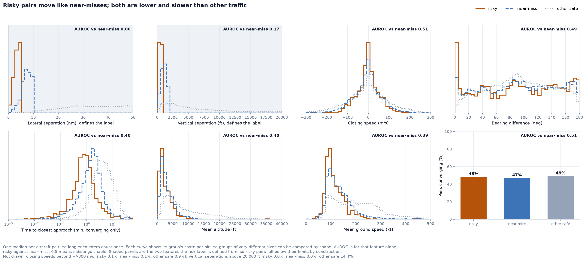

The two shaded panels show lateral and vertical separation, the features the label is defined from. Risky pairs fall below 5 nautical miles and 1,000 feet, and near-miss pairs between those limits and twice them, by construction; these panels describe the grouping rather than a finding. Among the remaining features, closing speed, bearing difference, and the share of pairs converging are almost identical across all three groups: about half of each group is converging, and closing speed centres near zero throughout. The features that would describe two aircraft heading towards each other do not separate risky pairs from safe ones under the current rule. What separates the groups is the kind of traffic involved: risky and near-miss pairs are both much lower and slower than other safe pairs, and risky pairs are somewhat lower and slower again. One difference in motion is visible: 7.5% of risky pairs have a bearing difference below 5 degrees, compared with 3.8% of near-miss pairs and 0.9% of other safe pairs, consistent with aircraft flying in company or in the same traffic pattern.

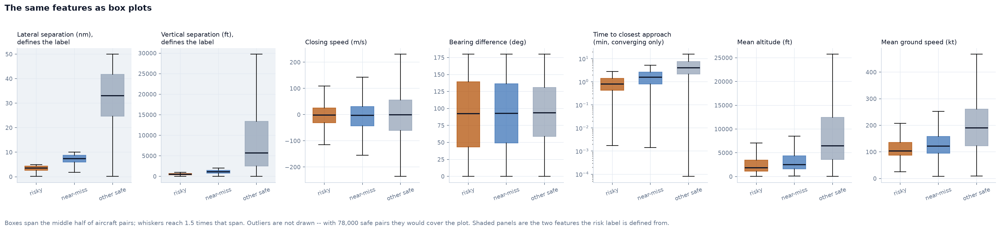

The box plots show the same pattern more compactly. Apart from the two shaded, label-defining features, the middle half of each group overlaps heavily for closing speed and bearing difference, while altitude and ground speed shift downward from other safe to near-miss to risky pairs.

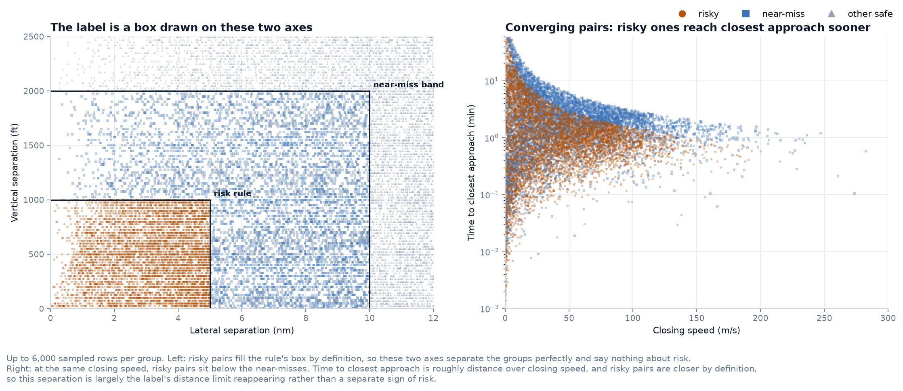

The left panel shows that the risky group is defined by a rectangle on lateral and vertical separation, so those two features separate the groups perfectly and carry no independent information about risk. In the right panel, converging risky pairs reach closest approach sooner than near-miss pairs at the same closing speed. Because time to closest approach is roughly distance divided by closing speed, and risky pairs are closer by definition, much of this difference reflects the label's distance limit rather than a separate sign of risk.

Taken together, these results explain the Step 6 finding that models perform poorly once the two label-defining features are removed. Under the current rule, a risky pair is mainly two low, slow aircraft that happen to be close together, not a pair whose motion distinguishes it from comparable safe traffic. This supports the label-definition question raised with the professor. The comparison covers one 58-minute window and the current rule only.

**Step 8 — Class distribution at different levels.** The positive rate depends on what is counted as one case. Six levels were measured, each with an explicit unit. A case is positive if it meets the current rule at least once; a pair's continuous stretch within range ends after 60 seconds unseen, and an aircraft's after 120 seconds. Aircraft are counted only when within 50 nautical miles of another aircraft.

| Level | Unit | Positive | Total | Rate |
|---|---|---:|---:|---:|
| Pair-observation | one pair at one moment | 24,016 | 4,156,014 | 0.58% |
| Visit | one pair, one continuous stretch | 2,200 | 94,248 | 2.33% |
| Aircraft pair | one pair over the hour | 2,078 | 78,233 | 2.66% |
| Aircraft-moment | one aircraft at one moment | 28,373 | 92,616 | 30.64% |
| Trajectory | one aircraft, one continuous stretch | 678 | 870 | 77.93% |
| Aircraft | one aircraft over the hour | 583 | 735 | 79.32% |

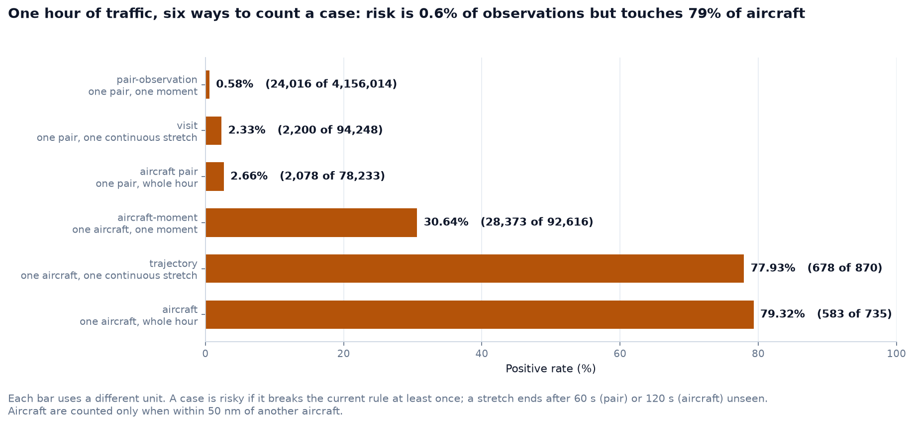

The rate rises from 0.58% of pair-observations to 79% of aircraft. At a randomly chosen moment, about 31% of aircraft are in at least one pair meeting the rule, and over the hour almost four in five are. The pair-level figures are the rare-event view usually reported; the aircraft-level figures show that, under the current rule, a positive is not a rare situation for an individual aircraft. This is relevant both to how severe the class imbalance really is and to what the label is measuring: a rule that applies to most aircraft in an ordinary hour of traffic is identifying proximity more than unusual danger.

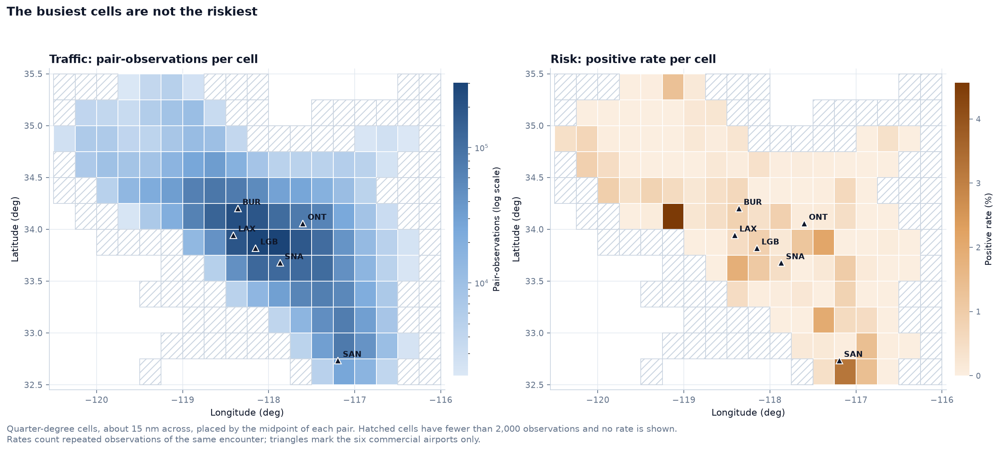

Step 4 mapped positive encounters only, which reflects where traffic is as much as where risk is. Here each cell's rate uses all of its pair-observations as the denominator. The two maps differ noticeably. The busiest cell, in the central Los Angeles basin, has 301,020 pair-observations but a rate of 0.18%, while the highest rates, between about 2% and 4.6%, occur in less busy cells. Several of these cells appear to contain general-aviation airfields, including the Camarillo and Oxnard area, McClellan-Palomar near Carlsbad, and Riverside, consistent with Step 4's observation that positives concentrate near light-aircraft fields; the field locations used for this reading still need to be checked against FAA data. Each cell's rate counts repeated observations of the same encounters, and the highest-rate cells contain between 37 and 124 distinct risky aircraft pairs, so individual cell rates should be read as indicative.

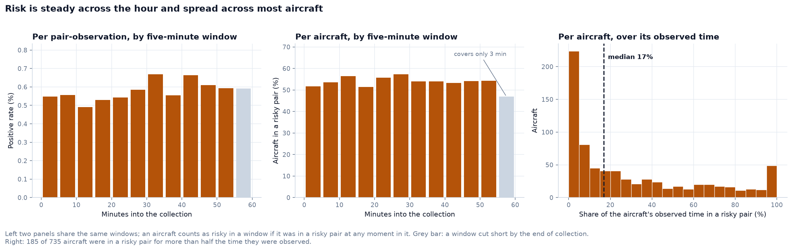

Across the hour, the observation-level rate stays between 0.49% and 0.67% per five-minute window, and between 51% and 57% of aircraft are in at least one risky pair in each full window. The final window covers only three minutes and is shown in grey. Per aircraft, the median aircraft spends 17% of its observed time in a risky pair, and 185 of the 735 aircraft do so for more than half the time they were observed. Step 4 already gives the rate by altitude band, from 1.70% below 3,000 feet to 0.011% above 18,000 feet. All of these figures come from one 58-minute window and the current rule.

**Step 9 — Observed aircraft track duration, accounting for censoring.** This measures how long each airborne aircraft has a fresh position report during the 58-minute collection; it is not the aircraft's full flight duration. A new track segment starts when reports for the same aircraft are separated by more than 120 seconds. Only airborne reports with positions no more than 15 seconds old are included.

The analysis found 873 observed track segments across 735 aircraft. Of these, 344 had both a visible start and enough data to confirm the segment ended; 231 were already present in the first frame (left-censored); 275 reached the end of the window before a 120-second report gap could confirm their end (right-censored); and 23 touched both boundaries. Median first-to-last observed duration was 960 seconds (16 minutes) among complete segments. Because many segments are censored, the censoring-aware Kaplan-Meier median was also calculated: 1,410 seconds (23.5 minutes), excluding left-censored segments whose start time is unknown and accounting for right-censored segments.

These are durations of observed track segments under the 120-second gap rule, not time airborne, full flight duration, or collision-event duration. The estimates describe only this one collection window.

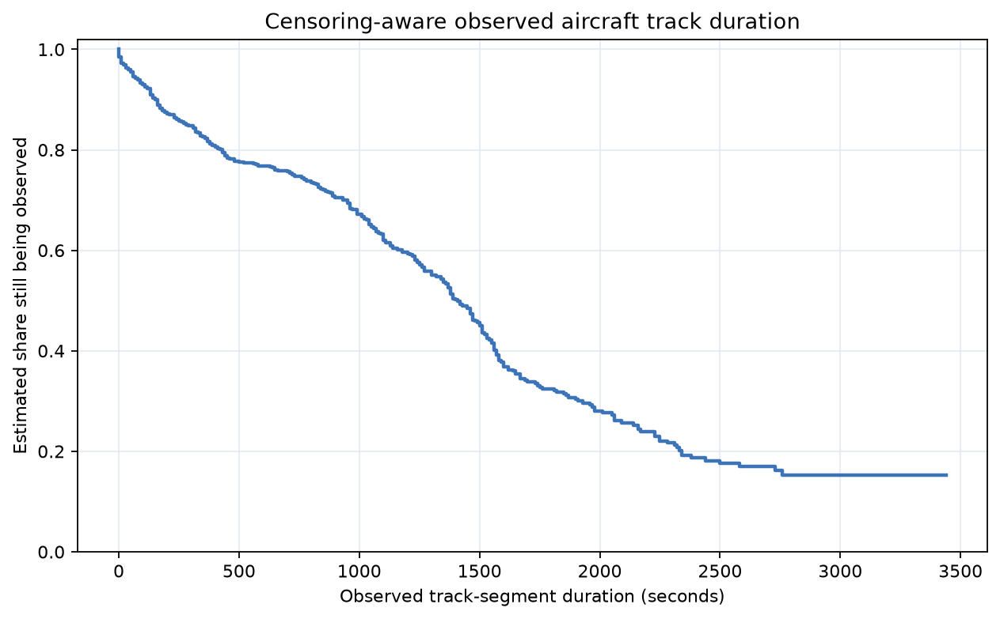

Reproduce with `python -m src.analysis.trajectory_duration`. The per-segment durations and censoring flags are in `experiments/eda/step9_trajectory_durations.csv`; the grouped summary and survival curve data are saved alongside it.

**Step 10 — Encounter rates at sampled times of day.** Four 30-minute sessions collected in Southern California on 2026-10-07 were processed independently through the same pair-feature and label pipeline. A risky pair-observation meets the current rule (within 5 nautical miles and 1,000 feet); aircraft-moments count each aircraft once per frame if it appears in a valid pair. Positive pair-encounters combine positive observations for the same two aircraft when the gap is no more than 60 seconds.

| Session start (PDT) | Frames | Pair-observations | Risky pair-observations | Rate | Risky aircraft-moments | Rate | Positive pair-encounters |
|---|---:|---:|---:|---:|---:|---:|---:|
| 6:39 AM | 167 | 265,095 | 1,033 | 0.390% | 1,680 / 17,187 | 9.77% | 131 (261/hour) |
| 10:18 AM | 145 | 2,147,415 | 18,090 | 0.842% | 16,453 / 41,980 | 39.19% | 1,741 (3,486/hour) |
| 2:30 PM | 168 | 1,352,992 | 10,645 | 0.787% | 10,862 / 39,706 | 27.36% | 1,121 (2,244/hour) |
| 7:39 PM | 169 | 763,009 | 4,460 | 0.585% | 5,686 / 27,262 | 20.86% | 526 (1,046/hour) |

The highest pair-observation and aircraft-moment rates occurred in the 10:18 AM sample; the lowest occurred in the 6:39 AM sample. These are descriptive differences between four samples, not a reliable daily schedule: there is only one session at each time and all four were collected on one date. The rates adjust for the number of valid pairs or aircraft-moments, but they do not control for traffic mix, coverage, or other day-specific conditions. They cannot establish a recurring time-of-day effect, a seasonal trend, or collision probability. The 10:18 AM capture also had fewer frames than the other sessions, so comparisons remain preliminary.

The session-level results are in `experiments/eda/step10_time_of_day_sessions.csv`, the five-minute within-session rates are in `experiments/eda/step10_time_of_day_windows.csv`, and the chart is `experiments/figures/step10_time_of_day_rates.png`. Reproduce with `python -m src.analysis.time_of_day`; timed session CSVs with a local-time suffix are discovered automatically.

The earlier single-snapshot dataset contained 8,309 pair rows and 55 positives (0.662%). Its class-distribution, feature-EDA, and logistic-regression imbalance figures are not shown here as current multi-frame results. Those earlier experiments remain historical context; model performance should be revisited using a suitable temporal split and the label definition agreed upon for the next stage.

**Step 11 — GraphSAGE baseline.** The GraphSAGE edge classifier was trained on the 661 training frames using the regenerated multi-session split. Training comprised 6,568,524 pair-observations, including 43,139 positives. Feature scaling was fit on training graphs only. The checkpoint with the best validation average precision was selected from five epochs. A plain logistic-regression baseline was also retrained on the same training observations and six pair features, so the comparison uses identical frames and labels. Each model's operating threshold was selected on validation by minimizing the project's 5:1 false-negative-to-false-positive cost; the test session was held out until final evaluation.

| Model | Validation-selected threshold | Test average precision | Test AUROC | Test precision | Test recall | Test normalised cost |
|---|---:|---:|---:|---:|---:|---:|
| GraphSAGE | 0.9950 | 0.895 | 0.9993 | 0.624 | 0.946 | 0.168 |
| Logistic regression | 0.1320 | 0.933 | 0.9995 | 0.668 | 0.954 | 0.140 |

The positive rate in the held-out evening session was 0.585% (4,460 of 763,009 pair-observations). On this test session, GraphSAGE did not outperform the simpler logistic-regression baseline: its average precision and normalized cost were worse. At a fixed 0.5 threshold, normalized cost was 1.433 for GraphSAGE and 0.221 for logistic regression; the validation-tuned thresholds (0.995 and 0.132 respectively) did not transfer equally well, showing that operating-threshold performance is sensitive to the session. Both models score highly because the current label is directly defined by lateral and vertical separation, which are included among the six input features; this measures how well they reproduce the rule, not whether they predict actual collisions. The result is preliminary: validation and test are each one session from the same date, and no broad hyperparameter search or independent-date evaluation was performed.

Reproduce with `python -m src.gnn.train --epochs 5 --patience 2`. The models are saved as `models/week5_graphsage.pt` and `models/week5_logistic_regression_shared_split.joblib`. Metrics, training history, and held-out predictions are in `experiments/eda/step11_graphsage_metrics.csv`, `experiments/eda/step11_graphsage_training.csv`, and `experiments/eda/step11_graphsage_test_predictions.csv`.

**Step 11 SMOTE follow-up (2026-10-08).** To follow the requested working approach, GraphSAGE was retrained with SMOTE applied to learned pair representations, not by inventing aircraft nodes or physical graph edges. In each training epoch, positive edge representations and a bounded random sample of negative representations were extracted from training graphs; SMOTE generated additional positive representations for the edge-classifier head. The synthetic rows were weighted in the loss according to their row counts. Validation and test data were not resampled. This increased the effective training positive share from 0.66% to 3.20% (43,139 real plus 172,556 synthetic positives across 6,568,524 original pair-observations).

| Model / strategy | Validation-selected threshold | Test average precision | Test AUROC | Test precision | Test recall | Test normalised cost |
|---|---:|---:|---:|---:|---:|---:|
| GraphSAGE, class-weighted run | 0.9950 | 0.895 | 0.9993 | 0.624 | 0.946 | 0.168 |
| GraphSAGE, latent SMOTE | 0.9226 | 0.837 | 0.9987 | 0.545 | 0.943 | 0.215 |
| Logistic regression, no resampling | 0.1320 | 0.933 | 0.9995 | 0.668 | 0.954 | 0.140 |

On this one held-out session, latent SMOTE did not improve GraphSAGE's average precision or normalized cost over the earlier class-weighted run or the logistic-regression baseline. At the fixed 0.5 threshold, SMOTE GraphSAGE recall was 0.997, but its precision was 0.205 and normalized cost 0.776 because it produced 17,229 false positives. Its validation-tuned threshold reduced false alarms, but did not change the ranking metrics. This is an initial SMOTE implementation rather than a systematic search over sampling ratios or methods; it shows the recall/false-alarm trade-off and does not establish SMOTE as the best GNN strategy.

The SMOTE model, metrics, training history, and test predictions are saved as `models/week5_graphsage_smote.pt`, `experiments/eda/step11_graphsage_smote_metrics.csv`, `experiments/eda/step11_graphsage_smote_training.csv`, and `experiments/eda/step11_graphsage_smote_test_predictions.csv`.

## Section V
### Conclusion

The multi-frame analysis shows that the positive class is both rare and temporally repeated. It also indicates that many observations meeting the current proximity rule are not converging. These findings motivate careful temporal splitting and a discussion about what the project’s risk label is intended to represent.

The results are preliminary: most analyses use one 58-minute Southern California backfill, and the time-of-day comparison adds only four sessions from one date. More dates and seasons are needed to establish recurring time patterns. No alternative label has been adopted, and no conclusions about actual collision events can be drawn from the current rule alone.
